# Web wireframes

Low-fidelity wireframes of the v1 web views, step 8 of the [v1 plan](../design/v1.md#plan). They must be approved before any web code is written.
They show layout, content and states only: grey boxes, real labels and no final styling.
Each view is drawn at 1280 px (desktop) and 375 px (mobile).

- Recipe and ingredient names, amounts, glasses, techniques, garnishes, steps and history come from [`data/`](../../data/).
- Prices are sample user data in CLP. Costs and prices are worked out with the formulas in the design (waste 10 %, target cost 25 %, tax 19 % included, rounding step 100, extras $150 per drink).
- The UI is shown in English. Every label exists in `es` and `en`.
- Numbered black circles in the images match the notes under each image.

## Contents

1. [Recipe list](#1-recipe-list)
2. [Recipe detail and step mode](#2-recipe-detail-and-step-mode)
3. [My bar](#3-my-bar)
4. [Ingredient page](#4-ingredient-page)
5. [Prices editor and cost states](#5-prices-editor-and-cost-states)
6. [Menu builder](#6-menu-builder)
7. [Print view](#7-print-view)
8. [Questions for review](#questions-for-review)

## 1. Recipe list

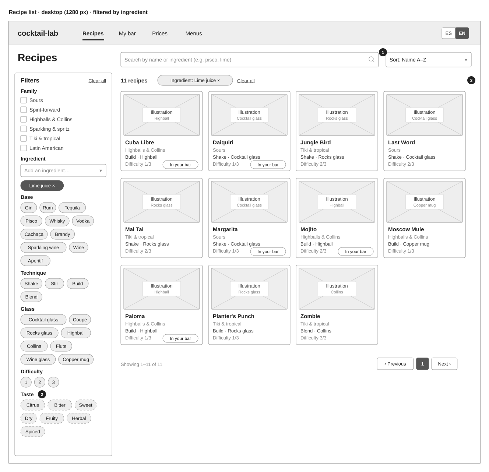

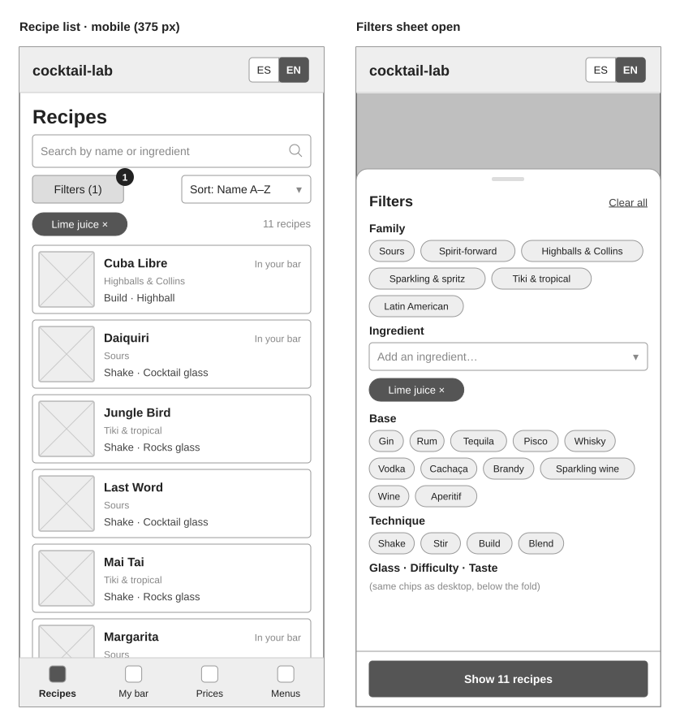

1. The search box matches a recipe name or an ingredient name in either language, ignoring case and accents. The search, the filters, the sort and the page all live in the URL query, so a filtered list can be shared.
2. The taste filter arrives with the `taste` field in plan step 14; dashed chips mark it as not yet available.
3. Each active filter is shown as a chip above the results and can be removed on its own. Here the list is filtered by the ingredient Lime juice (11 recipes). Cards show an SVG illustration built from `glass` and `color`, and an "In your bar" tag when nothing is missing for the user (see [My bar](#3-my-bar)). Pages hold 20 recipes.

On mobile, the filters open in a bottom sheet. Its button shows how many recipes match before the sheet is closed.

## 2. Recipe detail and step mode

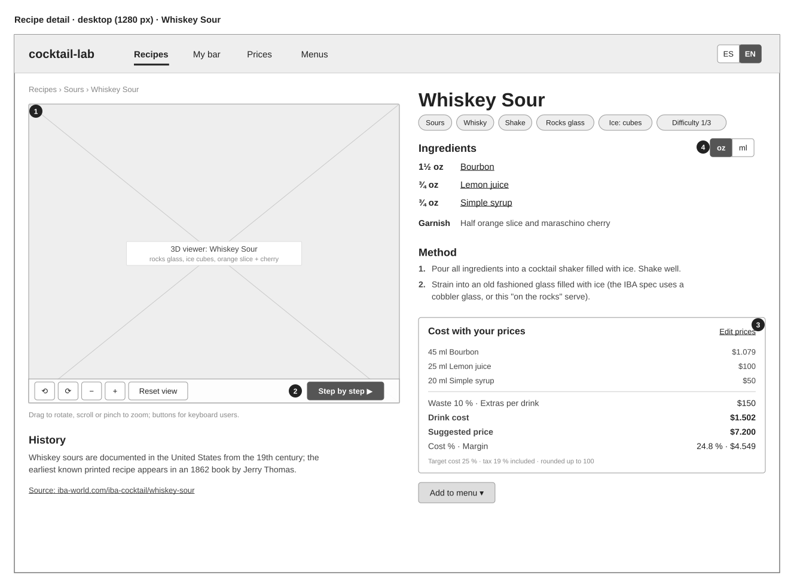

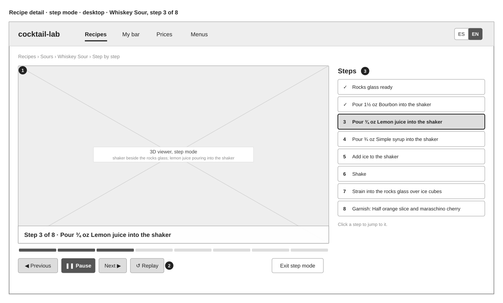

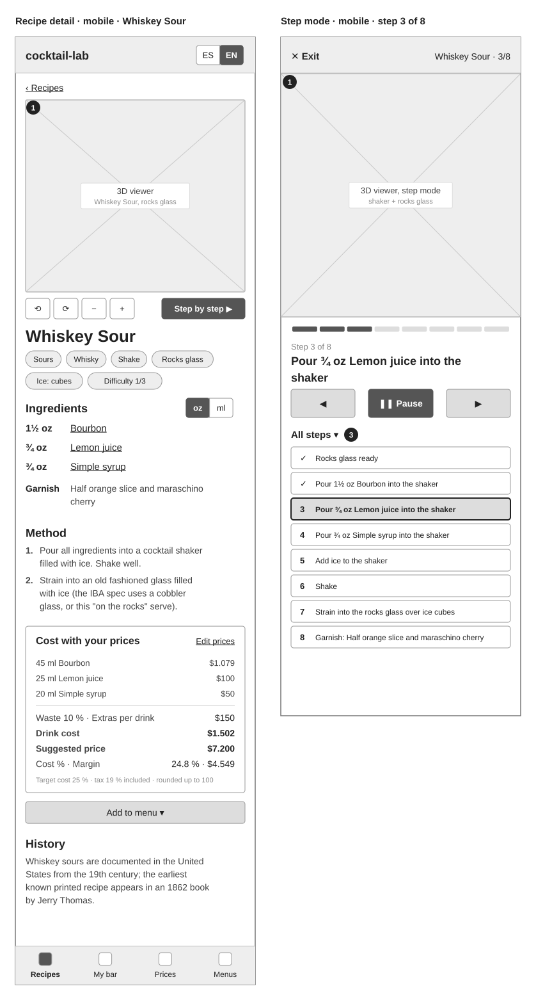

Whiskey Sour: shake, rocks glass, ice cubes, garnished with half an orange slice and a maraschino cherry.

1. The 3D viewer loads only on this page and only when needed (three.js and the viewer have their own budget of 300 KB gzip). Without WebGL it shows the SVG illustration. With `prefers-reduced-motion` nothing animates: each step shows its end state.
2. The rotate and zoom buttons work from the keyboard. "Step by step" starts the step mode.
3. Detail page: the cost uses the user's prices (here $1.502, suggested price $7.200) and links to the prices editor. When a price is missing, the card shows the incomplete state (see [cost states](#5-prices-editor-and-cost-states)). Step mode: the step list is the text version of the animation; the current step is outlined, done steps are ticked, and selecting a step jumps to it.
4. The oz / ml switch is the `displayUnit` setting, shown here as well as in Prices › Defaults. Ounces are rounded to quarters (45 ml = 1½ oz). Dash, barspoon, unit and top-up lines keep their own unit. The cost card always shows ml, because costing is in ml.

The step mode follows `planSteps`: the serving glass, each ingredient into the vessel the technique implies (a shaker for shake), ice, the technique, strain into the glass, the garnish. The Whiskey Sour has 8 steps; the wireframe shows step 3, "Pour ¾ oz Lemon juice into the shaker". On mobile, the step mode is full screen with the step list collapsible under the controls.

## 3. My bar

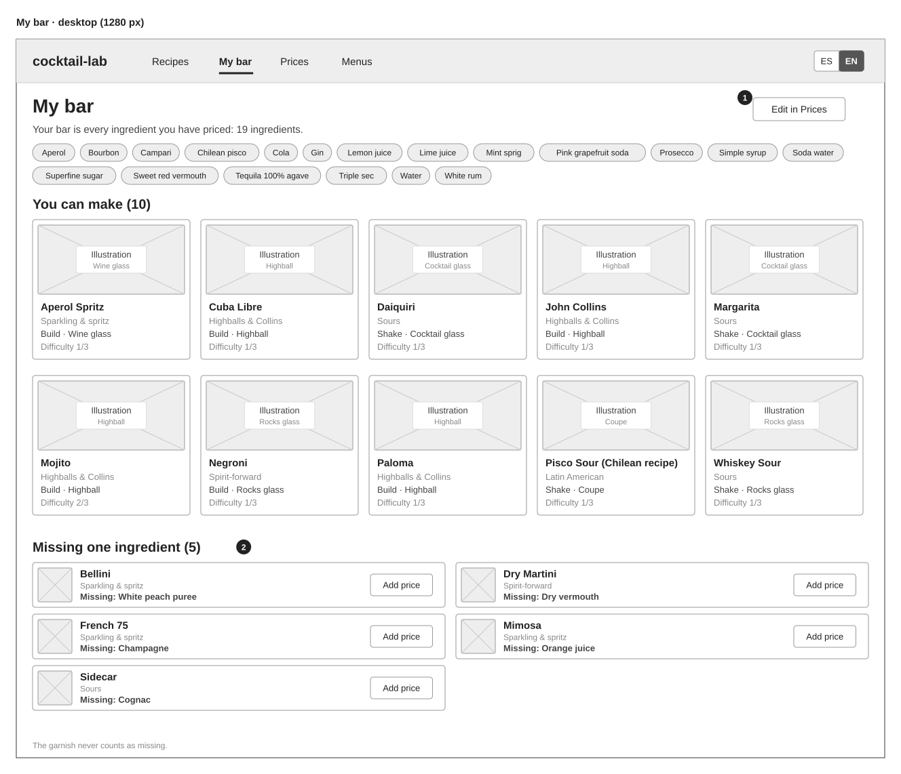

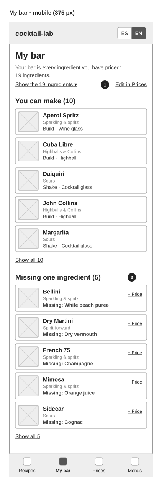

1. The bar is the set of ingredients with a price, so there is no second list to keep in sync. Changes are made in the prices editor.
2. Recipes missing exactly one ingredient name it, with a shortcut to price it. With the 19 sample prices, the user can make 10 recipes and is one ingredient away from 5 (for example Dry Martini: Dry vermouth). The garnish never counts as missing.

## 4. Ingredient page

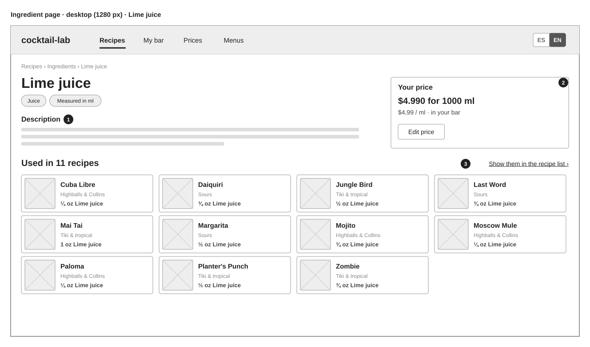

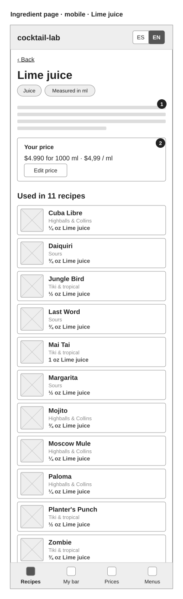

1. `description` is a short text in es/en, added to the data in plan step 15; it is drawn as grey lines until then. With no description, the section is not shown.
2. The user's price and the unit cost. Without a price, the panel says the ingredient is not in the bar and offers "Add price".
3. The recipes that use the ingredient, with the amount each one uses in the chosen unit. The link opens the recipe list filtered by this ingredient (the list in [section 1](#1-recipe-list)).

## 5. Prices editor and cost states

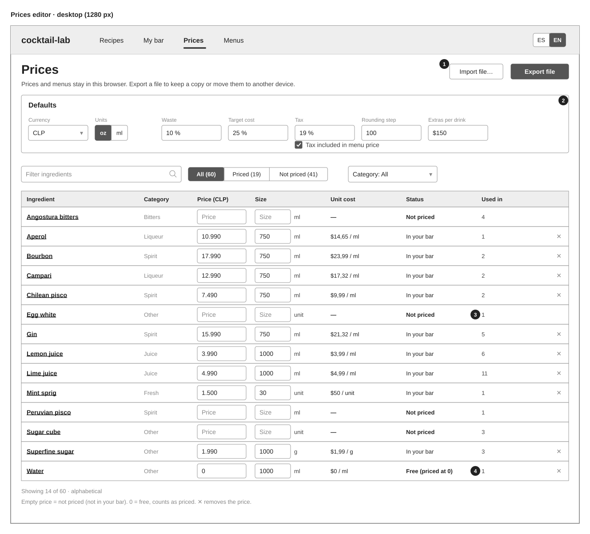

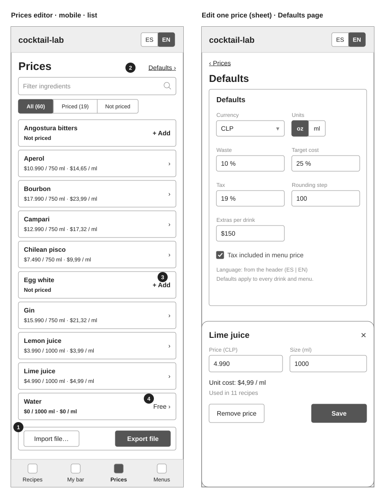

1. Prices and menus stay in this browser (`localStorage`). Export downloads `cocktail-lab-YYYY-MM-DD.json`. Import checks the file, shows a summary and asks before it replaces the current data.
2. Defaults: currency, display unit, waste, target cost, tax (and whether it is included in the menu price), rounding step and extras per drink. On mobile they have their own page.
3. Not priced: the price is empty. The ingredient is not in the bar, and every drink that uses it has an incomplete cost.
4. Priced at 0 (Water here): the ingredient is free. It counts as priced, is in the bar and costs $0 per line. An empty price and 0 are different states, and the editor shows them differently.

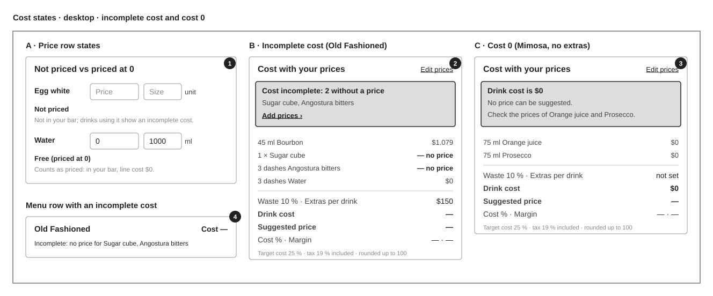

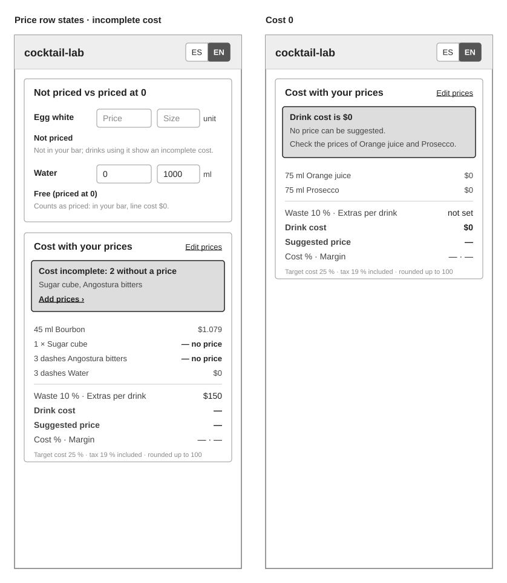

1. The two price row states side by side: empty versus 0.
2. **Incomplete cost** (Old Fashioned without prices for Sugar cube and Angostura bitters): the missing ingredients are named, their lines say "no price", and the drink cost, suggested price, cost % and margin show "—", never $0. The Water line, priced at 0, costs $0 and does not make the cost incomplete.
3. **Cost 0** (a Mimosa with Orange juice and Prosecco both priced at 0 and no extras): the drink cost is a real $0. No price can be suggested, because cost % and margin would divide by zero (the costing API answers 400 for a result that is not finite). The card says so and names the ingredients to check.
4. In a menu, an incomplete drink shows "—" with the missing ingredients named under it.

## 6. Menu builder

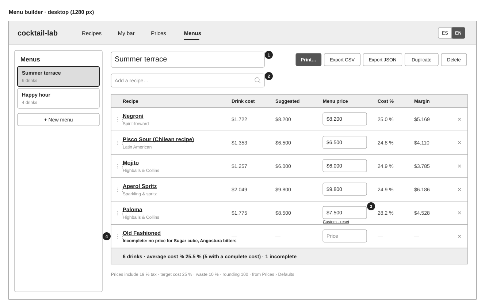

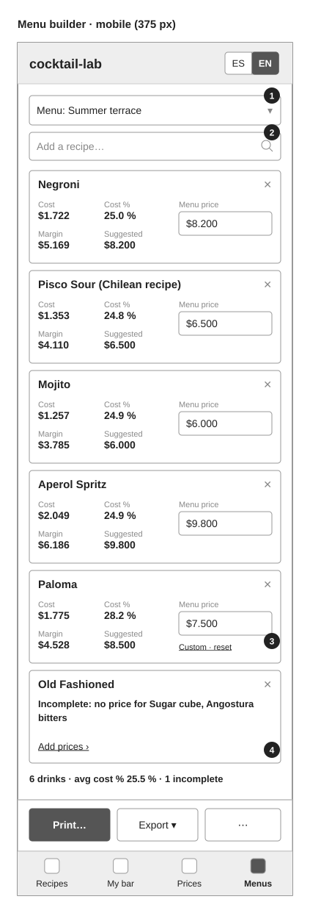

1. The menu name. A user can keep several menus (here "Summer terrace" and "Happy hour").
2. Recipes are added from a search box that works like the recipe list search. Rows can be reordered by dragging, or with the keyboard.
3. The menu price defaults to the suggested price. Typing a price sets `priceOverride`: cost % and margin are worked out from it (Paloma at $7.500 instead of $8.500 gives a cost of 28.2 %), and "reset" goes back to the suggested price.
4. A drink with an incomplete cost stays in the menu with "—" values and the missing ingredients named. The totals count only complete drinks: the average cost % is 25.5 % for 5 of 6.

Actions: print (see below), export as CSV and JSON, duplicate, delete (with confirmation).

## 7. Print view

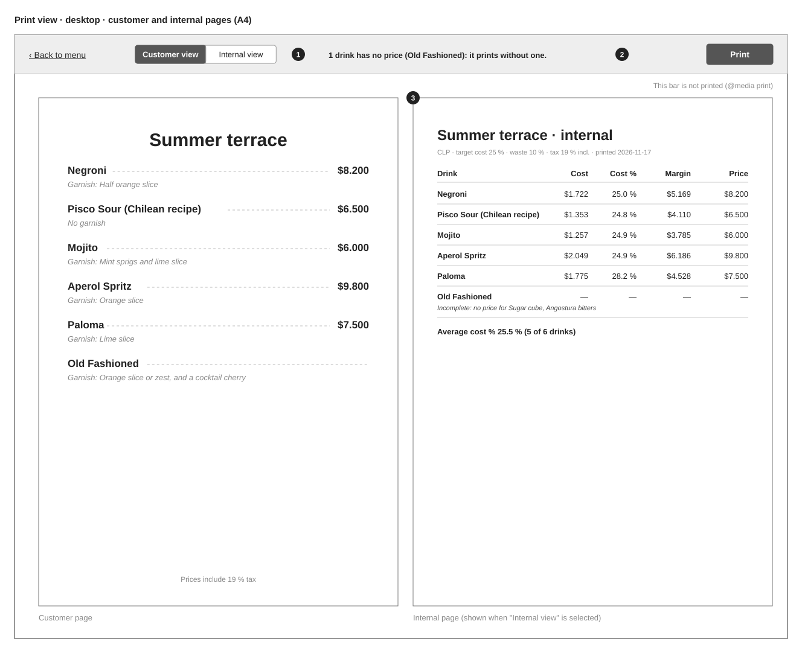

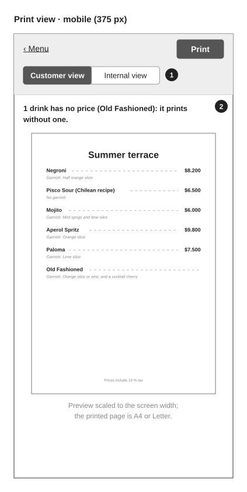

1. Two views of the same menu. The customer view shows name, garnish and price. The internal view shows cost, cost %, margin and price, with the settings used and the date. PDF comes from the browser's print dialog.
2. A drink with no price prints in the customer view without one, and the toolbar warns about it before printing.
3. The toolbar is screen only; `@media print` hides it, so the printed page is only the menu.

## Questions for review

These are choices the wireframes make that the design does not settle:

- Is the oz / ml switch on the recipe page the right place, in addition to Prices › Defaults?
- Cost 0: is "no suggested price" the right result, or should it suggest the rounding step (for example $100)?
- Customer print: should a drink without a price print without one (as drawn), be left out, or block printing?
- Is the bottom tab bar on mobile (Recipes, My bar, Prices, Menus) the right navigation?
